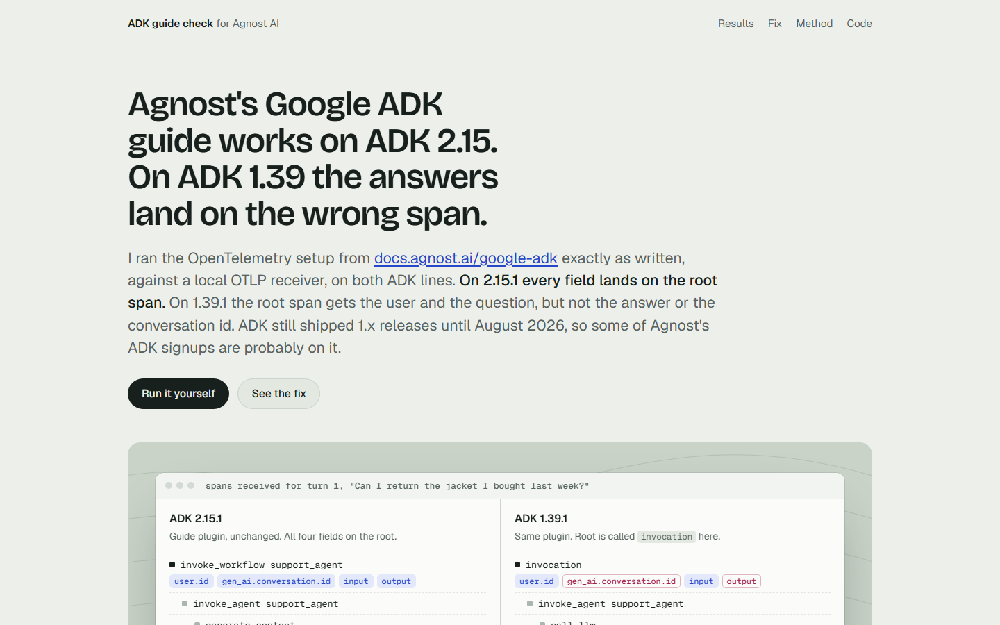

# Agnost ADK guide check

I ran the OpenTelemetry setup from [Agnost AI's Google ADK guide](https://docs.agnost.ai/google-adk) exactly as written, on two ADK versions, against a local OTLP receiver, and checked which span every field lands on.

**Live page:** https://agnost-adk-guide-check.vercel.app



## Problem

Agnost builds each conversation's transcript from the root span of a trace. Its ADK guide adds a small plugin that writes the user id, the user's message and the agent's answer onto that root span. If any of those land somewhere else, a new user's first trace looks empty, and that first trace is the activation step in Agnost's quickstart.

## Result

| ADK | Content capture | Plugin | Root: user | Root: conversation id | Root: input | Root: answer | Tool args + result |
|---|---|---|---|---|---|---|---|
| 2.15.1 | SPAN_ONLY | guide | yes | yes | yes | yes | yes |
| 2.15.1 | NO_CONTENT | guide | yes | yes | yes | yes | **no** |
| 2.15.1 | SPAN_ONLY | fixed | yes | yes | yes | yes | yes |
| 1.39.1 | SPAN_ONLY | guide | yes | **no** | yes | **no** | yes |
| 1.39.1 | NO_CONTENT | guide | yes | **no** | yes | **no** | yes |
| 1.39.1 | SPAN_ONLY | fixed | yes | yes | yes | yes | yes |

- On **ADK 2.15.1** the guide works as written. Row 2 confirms the guide's own warning: without `OTEL_INSTRUMENTATION_GENAI_CAPTURE_MESSAGE_CONTENT=SPAN_ONLY` the tool result is not exported.
- On **ADK 1.39.1** the root span is called `invocation`. The final-answer callback runs inside a child `generate_content` span, so `trace.get_current_span()` puts the answer there, and the root has no `gen_ai.conversation.id`. ADK published 1.x releases until 27 Aug 2026 (1.39.1), so 1.x users exist.
- `check/agnost_adk_plugin.py` keeps a handle on the root span per invocation and writes the answer and conversation id to it. It passes on both versions.

## How it works

- `check/run_guide.py` starts an OTLP/HTTP receiver on 127.0.0.1 that stands in for `otel.agnost.ai`, sets the guide's env vars (only the endpoint changes), and runs a two-turn ADK support agent with the guide's plugin copied unchanged. A scripted model replaces Gemini, so runs are offline and identical. It makes the two mistakes shown on agnost.ai: says 30 days when the policy tool said 14, and confirms a refund without calling `issue_refund`.
- `check/check_spans.py` reads every `check/out/spans_*.json` and writes `check/out/results.json`.

```bash
python -m venv .venv && .venv/Scripts/pip install -r requirements.txt   # ADK 2.15.1
PLUGIN=guide .venv/Scripts/python check/run_guide.py
PLUGIN=fixed .venv/Scripts/python check/run_guide.py
CAPTURE=NO_CONTENT .venv/Scripts/python check/run_guide.py
# repeat in a second venv with google-adk==1.39.1, then:
.venv/Scripts/python check/check_spans.py
```

## Limits

- Not checked inside Agnost's dashboard (I did not create an account). On 1.x, tool content sits in `gcp.vertex.agent.*` attributes; I don't know if Agnost's ingest reads them.
- A real Gemini model may nest spans slightly differently from the scripted one.
- Two ADK versions only, Python 3.12, Windows.

Made by Nitesh Kumar Yadav for the Agnost AI Growth Lead application, with Claude Code doing most of the typing. Not affiliated with Agnost AI or Google.
